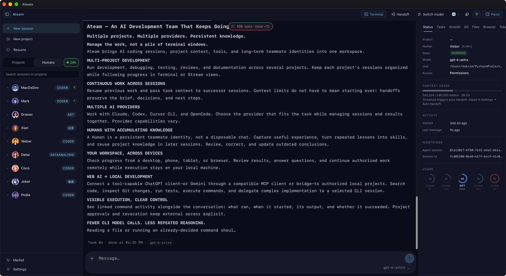

# Ateam

English | [中文](README.zh.md)

A desktop workspace for AI coding sessions, with terminal and Stream views,
per-teammate memory, session handoff, and authorized external MCP access.
Built with Tauri, React, TypeScript and a Node sidecar.

**Source available for noncommercial use under PolyForm Noncommercial 1.0.0.**
Commercial use requires a separate license from the copyright holder.
See [LICENSE](LICENSE). Do not describe this license as unrestricted open source.



## Core capabilities

### 1. Multiple projects in one workspace

- Run multiple AI coding sessions across multiple local projects.
- Organize work by project, teammate and session while retaining their identities.
- Use Terminal and Stream views to follow messages, changes, tool output and questions.
- Keep development, testing, review, documentation and maintenance work accessible.

### 2. Project-scoped task tracking

- Keep each project's task list alongside its coding sessions, with a project view
  and an all-projects view for tracking work across the workspace.
- Capture task details, tags and reminders; mark work complete or reopen it as needed.
- Let agents add and update tasks through the session-scoped tasks MCP, so follow-up
  work stays associated with the project instead of getting lost in a conversation.
- Open task details and return to the originating session when available.

### 3. Long-running work across session boundaries

- Pause and resume sessions, or hand work to a successor session when needed.
- Claude context-limit handoff carries a task briefing into the next session.
- Retain project context and teammate knowledge to reduce repeated investigation.
- Continuity means recovery and handoff, not infinite model context or guaranteed
  unattended correctness. Important actions still require authorization and review.

### 4. Multiple CLI providers

- Integrate Claude, Codex, Cursor CLI and OpenCode in the same desktop workspace.
- Choose a provider for the task and inspect its sessions and execution results.
- Keep long-lived teammate identities separate from individual model sessions.
- Resume, recall injection, MCP and handoff capabilities vary by provider and
  installed CLI version; feature parity across all providers is not promised.

### 5. Cross-provider context handoff and sharing

- Continue the same task with another provider instead of explaining the project
  again. For example: start with Claude, continue implementation in Codex, then
  take the conversation into Cursor CLI.
- **Switch model → another provider** converts the readable conversation between
  Claude, Codex and Cursor into a new native session for the target CLI. This
  path reads local history without asking the source model to summarize again,
  so it can help when that provider has run out of quota.
- **Handoff** is a separate option: ask the current model to prepare a task
  briefing and start a successor, optionally using a different provider.
- Supported sessions can also exchange task instructions, findings and review
  feedback through the peers MCP while remaining separate sessions. Messages do
  not grant extra permissions to the receiving session.
- Preserve the project, Human identity and source transcript; the source session
  is retired only after the successor starts successfully. Other provider pairs
  use a text/Markdown continuation path rather than native history conversion.

Migration is text-first: tool activity becomes labeled historical evidence,
not tool calls to replay. Hidden reasoning/system instructions, running tools,
sub-agent processes and image pixels are not transferred. The target provider's
own tools, permissions and context-window limits still apply.

### 6. Humans: accumulated knowledge with correction

- Each Human has a persistent identity, responsibilities, knowledge, skills and experience.
- Capture useful lessons and reuse them in later sessions instead of relearning them.
- Distill experience into skills, maintain knowledge, and revise incorrect or
  outdated conclusions after feedback and review.
- A model session ending does not erase the teammate's accumulated project knowledge.
- Stored knowledge remains reviewable; accumulation is not a guarantee of correctness.

### 7. Continue from desktop, phone, tablet or browser

- Inspect sessions and execution results from local desktop and browser/mobile surfaces.
- Use LAN access locally or authorized Remote/Relay access across networks.
- Review progress, confirm an action or continue a task from another device while
  development still happens on your own machine.
- Remote access and optional synchronization require explicit account/project permissions.

### 8. Local development from web AI clients

- External MCP lets a web AI coordinator discover authorized local projects and sessions.
- Read/search code, inspect Git changes, run tests and commands, and commit/push when authorized.
- Execute bounded operations directly through MCP; delegate complex implementation
  to the user's selected CLI session.
- Associate commands with a session to inspect their progress and results in Ateam.
- ChatGPT uses a tool-capable MCP connector. Gemini and other web AI clients require
  a compatible MCP client or bridge; native Gemini web connectivity is not claimed
  as verified here. Client plans and tool availability depend on the provider.

### 9. Reduce CLI model calls and token consumption

- Reading files, checking logs, running tests and executing an already-decided
  command need not trigger another CLI model reasoning and response cycle.
- Let the web AI use MCP directly and reserve CLI model calls for complex coding/debugging.
- **Optimization target: 99% fewer CLI model calls and tokens in workflows dominated
  by direct MCP execution.** This is a workflow-specific target, not a universally
  measured result or a guarantee; no common benchmark currently substantiates it.
- This concerns CLI-side calls/tokens, not all AI consumption or a guaranteed 99%
  reduction in total cost. The web AI still consumes resources and complex tasks
  still require model reasoning.

Provider CLIs and accounts are installed/authenticated separately. Their fees,
terms and feature availability are independent of Ateam.

## Build from source

Use Node 22, pnpm 9.15.9 (pinned in package.json), and the Rust stable toolchain
for desktop builds. Native modules must be built on the target OS.

```sh
pnpm install --frozen-lockfile
pnpm typecheck
pnpm --filter @ateam/desktop-ui build
pnpm --filter @ateam/sidecar build
pnpm --filter @ateam/desktop build
```

The last command creates desktop bundles; it does not install or restart an app.
See [desktop build prerequisites](apps/desktop/BUILD.md).
For a development desktop, build the sidecar first, then run
`pnpm --filter @ateam/desktop dev`.

## Hosted services and future pricing

This source retains the project's existing hosted Relay and update endpoints.
Remote account registration/sign-in connects to that hosted service; desktop
update checks use the configured update endpoint. LAN/Remote/Sync are optional.
See [service and data boundaries](HOSTED_SERVICES.md) before enabling them.

**Hosted server services may become paid in the future.** Pricing, limits and
service conditions will be announced separately. Publishing source does not
promise permanent free hosting or service availability. Source licensing and
hosted-service pricing are separate: access to a paid server service does not,
by itself, grant a commercial license to the software.

The Relay server source is included in `apps/relay`. Self-hosting requires
server configuration and maintenance; it is not a hosted-service entitlement.

## Repository map

- `packages/contract`: RPC types, events and validation.
- `packages/core`: sessions, providers, knowledge integration and external access.
- `packages/knowledge`, `packages/transport`: storage and communication primitives.
- `apps/desktop`: Tauri shell and React UI.
- `apps/sidecar`: desktop Node service and MCP entry points.
- `apps/relay`: remote-access server.
- `apps/cli`, `apps/tui`: command-line surfaces.

## Contributing and security

Read [CONTRIBUTING.md](CONTRIBUTING.md) and [SECURITY.md](SECURITY.md).
Do not attach credentials, private conversations or your Ateam data directory
in public issues. See [third-party notices](THIRD_PARTY_NOTICES.md) before
redistributing builds. This is alpha software; back up local data before upgrades.
