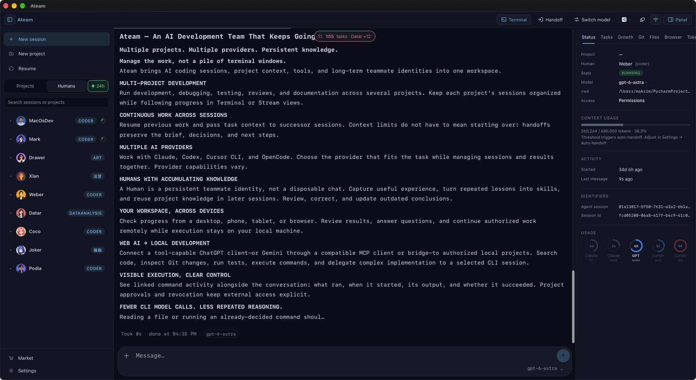

# Ateam

[English](README.md) | 中文

用于管理 AI 编程会话的桌面工作台：终端和 Stream 视图、成员记忆、会话交接，
以及经过项目授权的外部 MCP。基于 Tauri、React、TypeScript 和 Node sidecar。

**源码采用 PolyForm Noncommercial 1.0.0 非商业许可公开。**
商业使用须另行获得著作权人的许可，完整条款见 [LICENSE](LICENSE)。
这不是允许任意商业使用的开源许可证。



## 核心能力

### 1. 多项目并行，一个工作台管理

- 同时管理多个本地项目，每个项目可运行多个 AI 编程会话。
- 按项目、成员和会话组织工作，切换时保留各自的上下文与身份。
- 终端和 Stream 视图一起呈现消息、代码修改、工具执行和待确认事项。
- 适合同时推进开发、测试、代码审查、文档及维护任务。

### 2. 按项目的任务跟踪

- 每个项目都有对应的任务清单，可查看“本项目”或“全部项目”，并行工作也不漏掉待办。
- 记录任务详情、标签和提醒时间，支持完成、重新打开及后续跟进。
- Agent 可通过会话内的 tasks MCP 添加和更新任务，任务自动归属当前项目，
  不必只靠聊天记录记住下一步。
- 从任务详情回看上下文，并在原会话仍可定位时返回发起会话继续处理。

### 3. 长期、持续工作，不必每轮从零开始

- 会话可以暂停、恢复，并在需要时交接给继任会话。
- Claude 会话接近上下文限制时，可通过 handoff 文档延续任务。
- 将任务背景与成员知识保留下来，减少反复解释项目和重复调查。
- “持续工作”指恢复和交接机制，不代表单个模型拥有无限上下文，
  也不保证无人值守永不出错；关键操作仍应经过用户授权与验收。

### 4. 多供应商 CLI，复用同一个工作环境

- 集成 Claude、Codex、Cursor CLI 和 OpenCode provider。
- 根据任务选择供应商，在同一工作台管理不同 CLI 的会话和执行结果。
- 长期成员身份与具体模型会话分离，项目经验可以继续沉淀。
- 各 provider 的恢复、记忆注入、MCP 和交接能力有所不同，
  也受安装的 CLI 版本影响；不能假定所有能力完全相同。

### 5. Human：知识自累计，并能纠正旧经验

- 每个 Human 是持续存在的成员身份，拥有自己的职责、知识、技能与经验。
- 工作中记录有效经验，后续会话检索并复用，减少同一问题重复踩坑。
- 支持将经验提炼为技能、整理知识，并在反馈或复盘后修订错误、过时结论。
- 交接任务时带走已有积累，模型会话结束不意味着成员的项目经验清零。
- 沉淀内容仍需要审核；这是可积累、可修订的知识机制，不是正确性保证。

### 6. 多端远程：电脑、手机、平板继续同一份工作

- 本机桌面、浏览器和移动端可查看会话与执行结果。
- LAN 用于局域网访问，Remote/Relay 用于授权的远程访问。
- 在另一台设备查看进度、确认操作或继续输入，本地开发仍发生在你的机器上。
- 通过远程访问与可选同步服务衔接不同设备，项目权限与客户端授权仍须明确配置。

### 7. 网页 AI 也能操作本地开发环境

- 通过外部 MCP，让网页 AI 担任协调者，发现已授权的本地项目与会话。
- 可读取、搜索代码，检查 Git 差异，运行测试和命令；经授权后提交与推送。
- 简单工作由 MCP 直接执行，复杂实现再交给用户指定的 CLI 会话。
- 命令关联会话后，可在 Ateam 中看到执行过程与结果，方便回看和验收。
- ChatGPT 使用支持工具调用的 MCP connector。Gemini 或其他网页 AI
  需要兼容 MCP 的客户端/桥接；这里不承诺 Gemini 原生网页版已验证可直接连接。
- 网页产品的套餐、工具支持和账号权限由对应平台决定。

### 8. 降低 CLI 模型调用与 Token 消耗

- 不必为了读文件、查日志、运行测试或执行已确定的命令，
  让繁忙的 CLI 模型再理解、规划和转述一次。
- 网页 AI 通过 MCP 直接做这些确定性操作，把 CLI 模型留给复杂编码和调试。
- **优化目标：在以 MCP 直执行为主的工作流中，将 CLI 模型调用和 Token 消耗减少 99%。**
  这是特定工作流的目标，尚无统一基准测试证明所有项目都能达到该比例。
- 减少的是 CLI 侧的模型调用/Token，不代表网页 AI 本身没有消耗，
  也不等同于总成本降低 99%；复杂开发仍需要模型推理。

各 provider CLI 和账号需要独立安装、登录；其费用和条款与 Ateam 分开。

## 从源码构建

使用 Node 22、package.json 固定的 pnpm 9.15.9；桌面构建还需要 Rust stable。
原生模块需要在目标操作系统上构建。

```sh
pnpm install --frozen-lockfile
pnpm typecheck
pnpm --filter @ateam/desktop-ui build
pnpm --filter @ateam/sidecar build
pnpm --filter @ateam/desktop build
```

最后一条命令仅生成桌面安装包，不会安装或重启应用。
平台依赖见 [桌面构建说明](apps/desktop/BUILD.md)。
开发模式先构建 sidecar，再执行 `pnpm --filter @ateam/desktop dev`。

## 服务器服务与未来收费

公开源码保留现有托管 Relay 和更新服务地址。远程账号注册/登录连接托管服务，
桌面更新检查使用配置的更新地址；LAN、Remote、Sync 为可选功能。
启用前请阅读 [服务和数据边界](HOSTED_SERVICES.md)。

**托管服务器服务未来可能收费**，具体价格、额度和条件另行公布。
源码公开不承诺服务器永久免费或持续可用。源码许可与服务器收费分开：
支付服务器费用，本身不代表获得软件的商业使用许可。

仓库包含 `apps/relay` 服务器源码。自托管需要自行配置和维护，
不代表拥有对现有托管服务的访问权限。

## 参与与安全

请阅读 [贡献说明](CONTRIBUTING.md)、[安全说明](SECURITY.md) 和
[第三方组件说明](THIRD_PARTY_NOTICES.md)。公开 issue 不要附带凭据、
私人会话或 Ateam 数据目录。项目仍处于 alpha 阶段，升级前请备份本地数据。
